# Catálogo de aplicativos

Lista completa dos softwares disponíveis no **WinGet Toolkit**, com o ícone exibido
na interface e o *Package Identifier* usado na instalação.

**72 aplicativos** em **6 categorias**.

## Índice

- [Essencial](#essencial) — 5 aplicativos
- [Navegadores](#navegadores) — 5 aplicativos
- [Utilitários](#utilitários) — 25 aplicativos
- [Desenvolvimento](#desenvolvimento) — 18 aplicativos
- [Comunicação](#comunicação) — 5 aplicativos
- [Mídia & Jogos](#mídia--jogos) — 14 aplicativos

## Essencial

| Ícone | Aplicativo | Package ID (winget) | Descrição | Fonte |
| :---: | --- | --- | --- | --- |
|  | **Google Chrome** | `Google.Chrome` | Navegador web do Google | winget |
|  | **Microsoft 365 (Office)** | `Microsoft.Office` | Word, Excel, PowerPoint e Outlook | winget |
|  | **WhatsApp** | `9NKSQGP7F2NH` | Mensageiro instantâneo | Microsoft Store |
|  | **WinRAR** | `RARLab.WinRAR` | Compactador de arquivos | winget |
|  | **Java 8 (JRE)** | `Oracle.JavaRuntimeEnvironment` | Executa aplicativos e applets Java | winget |

## Navegadores

| Ícone | Aplicativo | Package ID (winget) | Descrição | Fonte |
| :---: | --- | --- | --- | --- |
|  | **Mozilla Firefox** | `Mozilla.Firefox` | Navegador open source | winget |
|  | **Brave** | `Brave.Brave` | Navegador focado em privacidade | winget |
| 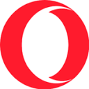 | **Opera** | `Opera.Opera` | Navegador com VPN integrada | winget |
| 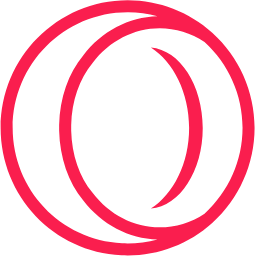 | **Opera GX** | `Opera.OperaGX` | Navegador para gamers | winget |
|  | **Vivaldi** | `Vivaldi.Vivaldi` | Navegador altamente customizável | winget |

## Utilitários

| Ícone | Aplicativo | Package ID (winget) | Descrição | Fonte |
| :---: | --- | --- | --- | --- |
|  | **7-Zip** | `7zip.7zip` | Compactador de arquivos | winget |
|  | **Everything** | `voidtools.Everything` | Busca instantânea de arquivos | winget |
| 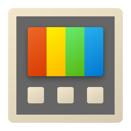 | **PowerToys** | `Microsoft.PowerToys` | Utilitários extras da Microsoft | winget |
|  | **Notepad++** | `Notepad++.Notepad++` | Editor de texto leve | winget |
|  | **Rufus** | `Rufus.Rufus` | Criação de pendrives bootáveis | winget |
| 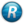 | **Revo Uninstaller** | `RevoUninstaller.RevoUninstaller` | Remoção completa de programas | winget |
|  | **TreeSize Free** | `JAMSoftware.TreeSize.Free` | Análise de uso de disco | winget |
|  | **WinDirStat** | `WinDirStat.WinDirStat` | Análise visual de disco | winget |
|  | **Windows Terminal** | `Microsoft.WindowsTerminal` | Terminal moderno da Microsoft | winget |
| 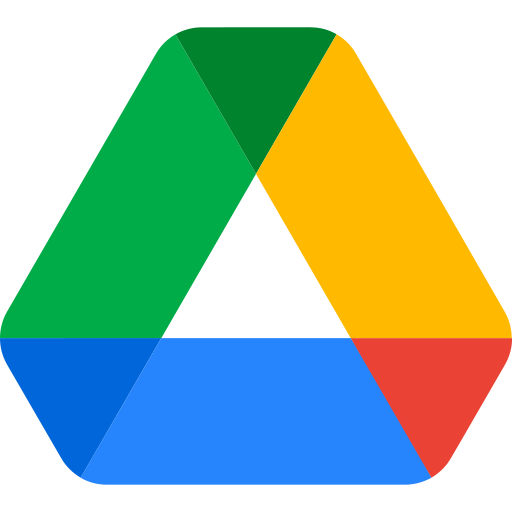 | **Google Drive** | `Google.GoogleDrive` | Armazenamento em nuvem | winget |
|  | **Dropbox** | `Dropbox.Dropbox` | Armazenamento em nuvem | winget |
|  | **Adobe Acrobat Reader** | `Adobe.Acrobat.Reader.64-bit` | Leitor de PDF | winget |
|  | **LibreOffice** | `TheDocumentFoundation.LibreOffice` | Suíte de escritório | winget |
|  | **Sumatra PDF** | `SumatraPDF.SumatraPDF` | Leitor de PDF leve | winget |
|  | **Foxit PDF Reader** | `Foxit.FoxitReader` | Leitor de PDF | winget |
|  | **Malwarebytes** | `Malwarebytes.Malwarebytes` | Anti-malware | winget |
|  | **Bitwarden** | `Bitwarden.Bitwarden` | Gerenciador de senhas | winget |
|  | **KeePassXC** | `KeePassXCTeam.KeePassXC` | Gerenciador de senhas offline | winget |
| 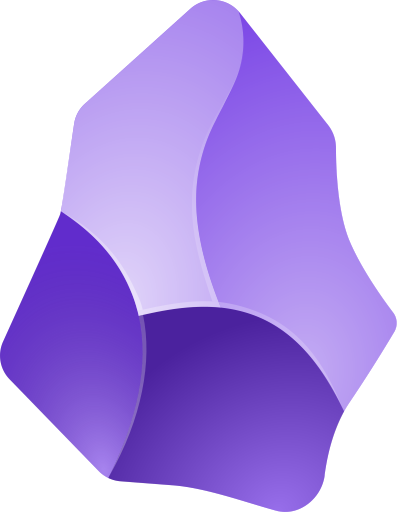 | **Obsidian** | `Obsidian.Obsidian` | Notas em Markdown com links | winget |
|  | **Power BI Desktop** | `Microsoft.PowerBI` | Relatórios e dashboards de dados | winget |
| 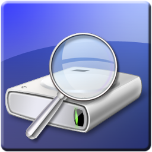 | **CrystalDiskInfo** | `CrystalDewWorld.CrystalDiskInfo` | Saúde dos discos via S.M.A.R.T. | winget |
|  | **WiFiman Desktop** | `Ubiquiti.WiFimanDesktop` | Análise de redes Wi-Fi da Ubiquiti | winget |
|  | **Cloudflare WARP** | `Cloudflare.Warp` | VPN e DNS seguro da Cloudflare | winget |
| 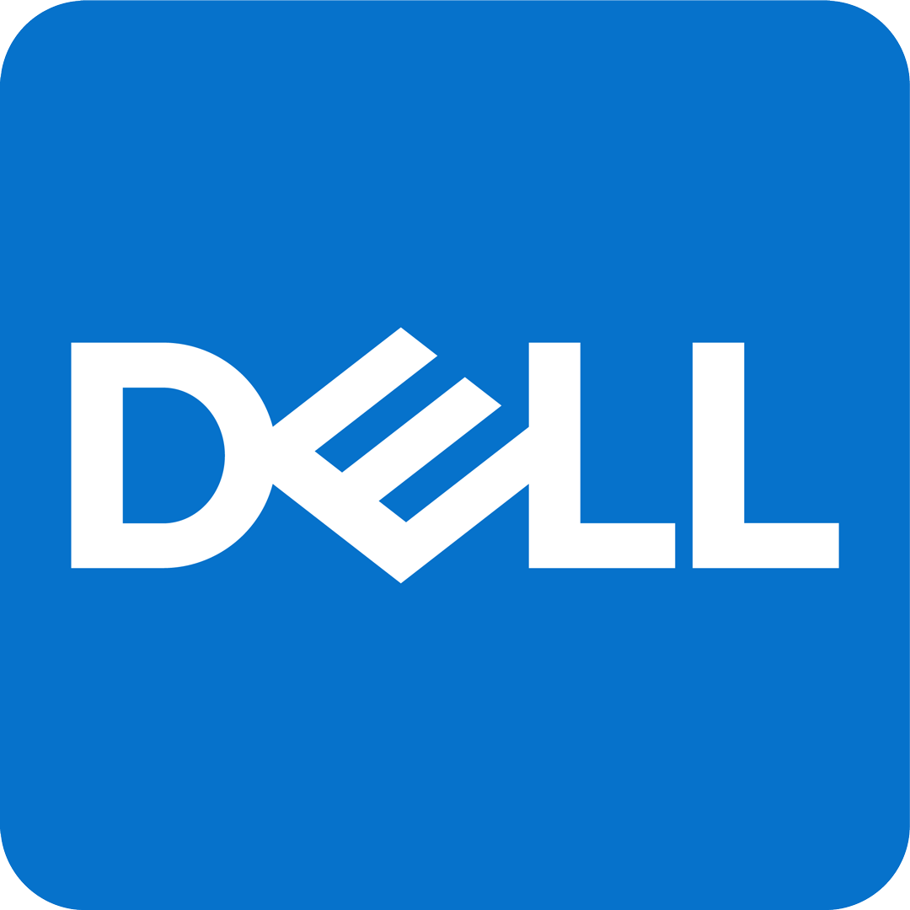 | **Dell SupportAssist** | `XPDCCXDN26VNBT` | Diagnóstico e drivers para PCs Dell | Microsoft Store |
|  | **Lenovo Vantage** | `9WZDNCRFJ4MV` | Diagnóstico e drivers para PCs Lenovo | Microsoft Store |

## Desenvolvimento

| Ícone | Aplicativo | Package ID (winget) | Descrição | Fonte |
| :---: | --- | --- | --- | --- |
|  | **Visual Studio Code** | `Microsoft.VisualStudioCode` | Editor de código | winget |
|  | **Git** | `Git.Git` | Controle de versão | winget |
|  | **Node.js LTS** | `OpenJS.NodeJS.LTS` | Runtime JavaScript | winget |
| 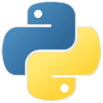 | **Python 3.12** | `Python.Python.3.12` | Linguagem de programação | winget |
|  | **Docker Desktop** | `Docker.DockerDesktop` | Containers no Windows | winget |
|  | **Postman** | `Postman.Postman` | Testes de API | winget |
|  | **GitHub Desktop** | `GitHub.GitHubDesktop` | Cliente gráfico do Git | winget |
|  | **PuTTY** | `PuTTY.PuTTY` | Cliente SSH/Telnet | winget |
|  | **DBeaver** | `DBeaver.DBeaver.Community` | Cliente universal de banco de dados | winget |
| 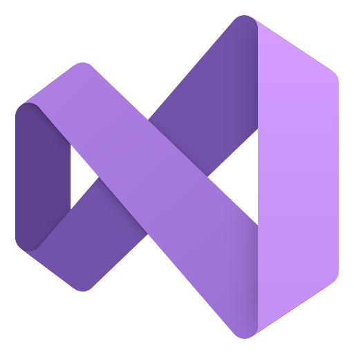 | **Visual Studio 2022** | `Microsoft.VisualStudio.2022.Community` | IDE completa da Microsoft (Community) | winget |
| 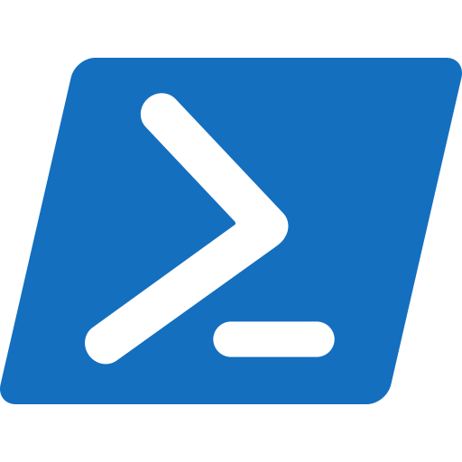 | **PowerShell 7** | `Microsoft.PowerShell` | Shell e linguagem de script multiplataforma | winget |
|  | **PowerShell Preview** | `Microsoft.PowerShell.Preview` | Versão de testes do PowerShell 7 | winget |
|  | **WSL** | `Microsoft.WSL` | Subsistema do Windows para Linux | winget |
| 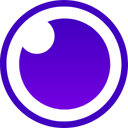 | **Insomnia** | `Insomnia.Insomnia` | Testes de API REST e GraphQL | winget |
|  | **mRemoteNG** | `mRemoteNG.mRemoteNG` | Gerenciador de conexões RDP, SSH e VNC | winget |
|  | **Windows App** | `Microsoft.WindowsApp` | Área de trabalho remota da Microsoft | winget |
|  | **Claude** | `Anthropic.Claude` | Assistente de IA da Anthropic | winget |
| 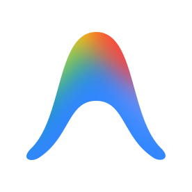 | **Antigravity** | `Google.Antigravity` | IDE com agentes de IA do Google | winget |

## Comunicação

| Ícone | Aplicativo | Package ID (winget) | Descrição | Fonte |
| :---: | --- | --- | --- | --- |
|  | **Discord** | `Discord.Discord` | Chat de voz e texto | winget |
|  | **Zoom Workplace** | `Zoom.Zoom` | Videoconferência | winget |
|  | **Slack** | `SlackTechnologies.Slack` | Chat corporativo | winget |
|  | **Microsoft Teams** | `Microsoft.Teams` | Chat e reuniões | winget |
|  | **Telegram** | `Telegram.TelegramDesktop` | Mensageiro instantâneo | winget |

## Mídia & Jogos

| Ícone | Aplicativo | Package ID (winget) | Descrição | Fonte |
| :---: | --- | --- | --- | --- |
|  | **VLC Media Player** | `VideoLAN.VLC` | Player de vídeo universal | winget |
|  | **Spotify** | `Spotify.Spotify` | Streaming de música | winget |
|  | **OBS Studio** | `OBSProject.OBSStudio` | Gravação e transmissão de vídeo | winget |
|  | **HandBrake** | `HandBrake.HandBrake` | Conversor de vídeo | winget |
|  | **Audacity** | `Audacity.Audacity` | Edição de áudio | winget |
|  | **K-Lite Codec Pack** | `CodecGuide.K-LiteCodecPack.Standard` | Pacote de codecs de vídeo | winget |
|  | **GIMP** | `GIMP.GIMP` | Edição de imagens | winget |
| 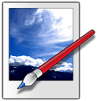 | **Paint.NET** | `dotPDN.PaintDotNet` | Editor de imagens simples | winget |
| 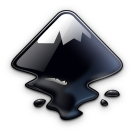 | **Inkscape** | `Inkscape.Inkscape` | Edição de vetores | winget |
| 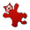 | **IrfanView** | `IrfanSkiljan.IrfanView` | Visualizador de imagens | winget |
|  | **ShareX** | `ShareX.ShareX` | Captura de tela e anotações | winget |
|  | **Steam** | `Valve.Steam` | Plataforma de jogos | winget |
|  | **Epic Games Launcher** | `EpicGames.EpicGamesLauncher` | Plataforma de jogos | winget |
|  | **GOG Galaxy** | `GOG.Galaxy` | Plataforma de jogos | winget |

## Resumo por categoria

| Categoria | Aplicativos |
| --- | ---: |
| Essencial | 5 |
| Navegadores | 5 |
| Utilitários | 25 |
| Desenvolvimento | 18 |
| Comunicação | 5 |
| Mídia & Jogos | 14 |
| **Total** | **72** |

## Observações

- Todos os `Package ID` foram validados contra o `winget search` real — cada um resolve
  para um pacote existente no momento da geração desta lista.
- **WhatsApp**, **Dell SupportAssist**, **Lenovo Vantage** vêm da
  **Microsoft Store** (`--source msstore`), porque não há pacote equivalente no
  repositório padrão do winget. Todos os demais vêm do repositório `winget`.
- **Java 8 (JRE)** é a única versão da Oracle publicada no winget. Para versões mais
  novas use uma distribuição OpenJDK (ex.: Eclipse Temurin).
- Os ícones são marcas registradas de seus respectivos fabricantes, incluídos aqui
  apenas para identificação visual dos softwares.

---

Gerado automaticamente a partir de [`src/js/apps.js`](src/js/apps.js).
